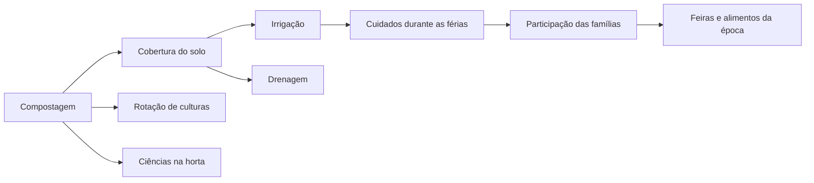

# Horta Viva · Citizen Assist AI

**FIAP · Global Solution 2026.2 · Desafio CitizenTech**

Assistente digital de orientação comunitária sobre alimentação consciente, cultivo sustentável e hortas escolares. Ele responde perguntas ou navega por temas, cita a fonte de cada orientação e avisa quando não tem base para responder.

## Equipe HortaTeam

| Integrante | RM |
|---|---|
| Antuny Marques de Menezes | RM 572105 |
| Éric Yuiti Nissi | RM 573495 |
| Vinícius Pelogia do Nascimento | RM 572675 |

## Vídeo de apresentação

Assista à apresentação do Horta Viva: [https://youtu.be/mqiYdiFOl2A](https://youtu.be/mqiYdiFOl2A)

**Queremos concorrer ao pódio da Global Solution 2 (GS2).**

## Problema, público e temas

**Problema.** As orientações oficiais sobre alimentação saudável e hortas escolares existem, mas estão espalhadas em PDFs longos e técnicos, como o Guia Alimentar do Ministério da Saúde e os manuais da Embrapa e do FNDE. Uma família, um professor ou um voluntário que quer saber "como regar sem desperdiçar água" ou "como envolver as famílias na horta" precisa procurar em vários documentos.

**Público.** Famílias de estudantes, professores e equipes escolares, e a comunidade em torno de hortas escolares e comunitárias.

**Relação com direitos e serviços.** O tema se liga ao direito à alimentação adequada e a dois programas públicos: o Programa Nacional de Alimentação Escolar (PNAE), que inclui educação alimentar e compra da agricultura familiar, e o Programa de Aquisição de Alimentos (PAA). O Horta Viva é uma proposta acadêmica: ele orienta e indica a fonte, e a execução dessas políticas cabe aos órgãos responsáveis. [PNAE — FNDE](https://www.gov.br/fnde/pt-br/acesso-a-informacao/acoes-e-programas/programas/pnae/agricultura-familiar-pnae) · [PAA — MDS](https://www.gov.br/mds/pt-br/acoes-e-programas/acesso-a-alimentos-e-a-agua/programa-de-aquisicao-de-alimentos)

**Temas da base (3 temas, 18 orientações):**

| Tema | Assuntos |
|---|---|
| Alimentação consciente | Alimentos in natura · Ultraprocessados · Planejamento de refeições · Comer com atenção · Feiras e alimentos da época · Habilidades culinárias |
| Cultivo sustentável | Compostagem · Irrigação · Cobertura do solo · Local da horta · Drenagem dos canteiros · Rotação de culturas |
| Educação comunitária e hortas escolares | Matemática na horta · Ciências na horta · Participação das famílias · Cuidados durante as férias · Educação alimentar na escola · Integração ao currículo |

## Estrutura de pastas

```text
├── README.md
├── requirements.txt          # dependências só do app web e dos testes
├── pytest.ini
├── data/
│   ├── conhecimento.json     # base de orientações verificadas
│   ├── perguntas_teste.json  # 22 perguntas do conjunto principal
│   ├── perguntas_validacao.json  # 14 perguntas novas para validar a melhoria
│   └── programa_escolar.json # dados fictícios do calendário (app web)
├── docs/
│   ├── modelos_resposta.md   # modelos de instrução A e B e comparação
│   ├── teste_usabilidade.md  # roteiro, dificuldades e melhorias
│   ├── uso_ia.md             # uso de IA e validação crítica
│   ├── resultados_testes.md / .csv    # rodada 2 (gerado)
│   ├── resultados_rodada1.md / .csv   # linha de base (gerado)
│   └── resultados_usabilidade.md      # roteiro executado (gerado)
├── src/
│   ├── sistema.py            # interface textual (entrega principal)
│   ├── avaliar.py            # executa os testes e gera os relatórios
│   ├── app.py                # interface web opcional (Streamlit)
│   └── modulos/
│       ├── assistente.py     # leitura, validação, temas, grafo e busca
│       ├── modelos_resposta.py
│       ├── interface_texto.py
│       ├── avaliacao.py
│       ├── usabilidade.py
│       └── gamificacao*.py, programa_escolar.py  # módulos extras do app web
├── assets/                   # imagens do app web
└── tests/                    # 48 testes automatizados
```

## Como executar

Requer **Python 3.11 ou superior**. A interface textual usa só a biblioteca padrão, então não é preciso instalar nada. Na raiz do repositório:

```bash
python src/sistema.py
```

O menu oferece: **1** fazer uma pergunta, **2** explorar por tema, **3** consultar por identificador, **4** trocar o modelo de resposta, **5** rodar as perguntas de teste e ver os indicadores, **0** sair.

Outros comandos:

```bash
python src/avaliar.py                       # regenera os relatórios em docs/
python -m pip install -r requirements.txt   # só para o app web e os testes
python -m pytest -q                         # 48 testes
python -m streamlit run src/app.py          # interface web opcional
```

## Base de conhecimento

Arquivo: [`data/conhecimento.json`](data/conhecimento.json), uma lista de 18 orientações. Cada registro tem:

| Campo | Obrigatório | Conteúdo |
|---|---|---|
| `id` | sim | Identificador único no formato tema-número (`cultivo-02`) |
| `tema`, `subtema` | sim | Posição na hierarquia de assuntos |
| `palavras_chave` | sim | Lista de termos e expressões usados pela busca |
| `perguntas_exemplo` | sim | Lista de formas comuns de perguntar |
| `resumo` | sim | Orientação em uma frase |
| `resposta` | sim | Orientação resumida da fonte |
| `fonte`, `url_fonte` | sim | Referência verificável e link `http(s)` |
| `data_consulta` | sim | Data de verificação no formato `AAAA-MM-DD` |
| `relacionados` | não | Identificadores de assuntos ligados (arestas do grafo) |
| `aviso` | não | Pedido de confirmação específico, exibido com a orientação |

**Origem.** As orientações resumem quatro fontes públicas: o Guia Alimentar para a População Brasileira (Ministério da Saúde), o manual Hortas Pedagógicas e o livro 500 Perguntas, 500 Respostas: Hortas (Embrapa) e a publicação Hortas escolares (FNDE, WFP, FAO e ABC). Os links estão em [Referências](#referências).

**Validação.** `carregar_base()` trata arquivo ausente, JSON inválido, lista vazia, campos de texto ou listas faltando, link ou data inválidos, aviso vazio, identificador duplicado e relacionado inexistente. Cada caso gera uma mensagem compreensível. Se a base for inválida, a interface textual explica o erro e encerra com código 1.

**Manutenção.** Para incluir ou corrigir uma orientação, edite só o JSON; nenhuma regra do programa precisa mudar. Um registro com referência ainda não conferida usa `"fonte": "Pendente de validação"` com `url_fonte` e `data_consulta` em `null`. Ele é aceito, mas fica fora da busca e aparece como pendente na navegação.

## Estruturas de dados e estratégia de busca

| Estrutura | Onde | Uso |
|---|---|---|
| Lista de dicionários | `carregar_base()` | A base carregada, um dicionário por orientação |
| Dicionário `id → orientação` | `indexar_por_id()` | Consulta direta por identificador e acesso aos vizinhos do grafo |
| Hierarquia `tema → subtema → [orientações]` | `organizar_por_tema()` | Menu "Explorar por tema" |
| Grafo de assuntos (lista de adjacência) | campo `relacionados` + `relacionados()` | "Continue explorando" depois de cada resposta |

**Grafo de assuntos relacionados.** Cada orientação aponta para três outras. As ligações seguem dois critérios: continuidade prática dentro do tema (compostagem → cobertura do solo → irrigação) e pontes entre temas quando um assunto leva ao outro (irrigação → cuidados durante as férias, porque o recesso exige combinar a rega; alimentos in natura → educação alimentar na escola). Um trecho do grafo:



**Busca por pergunta, em duas etapas.** A pergunta é normalizada: minúsculas, sem acentos e sem pontuação.

1. **Etapa 1, alta precisão** (busca original). Uma palavra-chave completa encontrada na pergunta, combinada com a cobertura dos termos e com a semelhança de texto com as perguntas de exemplo (`difflib.SequenceMatcher`), gera uma pontuação de 0 a 1. O mínimo para responder é 0,52.
2. **Etapa 2, correspondência aproximada** (só quando a etapa 1 não encontra nada). A pergunta vira um conjunto de radicais simples: sem palavras vazias, plural ou terminações verbais. A pontuação é a fração do peso da pergunta coberta pelo vocabulário da orientação, com peso **IDF**: termos raros na base pesam mais, e termos desconhecidos pesam o máximo e derrubam a cobertura. Para responder, são precisos cobertura de pelo menos 0,45 e pelo menos dois termos casados nos campos de índice. A resposta vem com o aviso *"Entendi que sua dúvida é sobre…"*.

**Várias correspondências.** As orientações acima do limiar são ordenadas pela pontuação. Se a segunda ficar a até 0,12 da primeira (0,10 na etapa 2), o resultado é **ambíguo**: o assistente lista as opções numeradas e o usuário escolhe. Se nada passar do limiar, o assistente **não responde**, explica o limite e sugere até três assuntos com termos em comum com a pergunta, inclusive termos parecidos, para erros de digitação. Sem nenhum termo em comum, sugere um assunto de cada tema.

A busca percorre todas as orientações (custo linear), o que basta para uma base pequena. Com milhares de registros, um índice invertido seria o próximo passo.

## Regras de resposta e modelos de instrução

| Condição | Resposta |
|---|---|
| Entrada vazia ou só pontuação | "Digite uma pergunta para consultar o assistente." |
| Uma orientação acima do limiar | Orientação, fonte com data e link, avisos e assuntos relacionados |
| Correspondência só na etapa 2 | O mesmo, precedido de "Entendi que sua dúvida é sobre…" |
| Duas ou mais orientações empatadas | Lista numerada para o usuário escolher |
| Nada acima do limiar | Aviso de limite, sugestões numeradas e aviso de informação não oficial |
| Orientação com `aviso` | Linha "Atenção:" com o pedido de confirmação específico |

**Dois modelos de instrução** (detalhes em [docs/modelos_resposta.md](docs/modelos_resposta.md)):

- **Modelo A · resposta direta:** texto corrido com o nome da fonte.
- **Modelo B · assistente educativo estruturado (padrão):** papel definido, formato fixo, fonte com data e link obrigatória, avisos e limites explícitos.

| Critério nas 22 perguntas do conjunto principal | Modelo A | Modelo B |
|---|---|---|
| Cita fonte, data de consulta e link | 0/12 | 12/12 |
| Inclui aviso de limitação ou de confirmação | 0/19 | 19/19 |
| Oferece opções numeradas para continuar | 0/8 | 20/20 |
| Explica o limite e diz o que fazer | 0/10 | 10/10 |
| Palavras por resposta encontrada (média) | 41 | 118 |

O modelo B foi escolhido porque é o único que cumpre as obrigações de fonte, aviso e continuidade. O custo é a resposta ficar cerca de 2,9 vezes mais longa, o que mitigamos com rótulos fixos e o resumo de uma frase no início.

## Tratamento de limitações e entradas inválidas

| Situação | Exemplo | Comportamento |
|---|---|---|
| Entrada vazia no menu | Enter | "Entrada vazia. Digite o número de uma opção do menu." |
| Opção inexistente | `9`, `abc` | "Opção inexistente. Digite um número de 0 a 5." |
| Pergunta vazia | Enter, `???` | "Digite uma pergunta para consultar o assistente." |
| Pergunta ambígua | "Compostagem ou irrigação?" | Lista as duas opções para escolha |
| Pergunta fora do escopo | "Qual remédio tomar para dor de cabeça?" | Não responde, explica o limite e sugere assuntos |
| Palavras do domínio sem base | "Qual o horário da merenda na escola do meu filho?" | Não responde, apesar de "merenda" ser palavra-chave |
| Identificador inexistente | `cultivo-99` | Explica o formato e sugere assuntos |
| Fim da entrada (Ctrl+D ou Ctrl+Z) | | Encerra sem erro |
| Base ausente ou inválida | | Mensagem de erro e código de saída 1 |

## Exemplos de uso

Pergunta encontrada por correspondência aproximada, com aviso específico:

```text
Sua pergunta: Quero aprender a cozinhar, por onde começo?
Entendi que sua dúvida é sobre "Habilidades culinárias". Se não for isso, reformule a pergunta ou explore os temas.
== Habilidades culinárias · Alimentação consciente · alimentacao-06 ==
Resumo: Pratique preparações simples e compartilhe o que aprendeu.
Orientação: Escolha uma preparação que você já gosta de comer. Peça a alguém que saiba fazê-la para ensinar, pratique e compartilhe as tarefas. Crianças podem ajudar em atividades adequadas à idade, com supervisão.
Fonte: Ministério da Saúde — Guia Alimentar para a População Brasileira (consultada em 17/11/2026)
Link: https://bvsms.saude.gov.br/bvs/publicacoes/guia_alimentar_populacao_brasileira_2ed_atualizada.pdf
Atenção: Atividades de crianças na cozinha precisam de supervisão de um adulto.
Aviso: Conteúdo educativo de um protótipo acadêmico, sem vínculo com órgãos públicos. Confirme informações atualizadas na fonte indicada.
Continue explorando:
  1. Planejamento de refeições (Alimentação consciente)
  2. Alimentos in natura (Alimentação consciente)
  3. Educação alimentar na escola (Educação comunitária e hortas escolares)
```

Navegação por três assuntos relacionados (escolhendo `1` duas vezes a partir de "Como fazer compostagem?"):

```text
Caminho: Compostagem > Cobertura do solo > Irrigação
```

Pergunta sem base confiável:

```text
Sua pergunta: Qual o horário da merenda na escola do meu filho?
Não encontrei uma orientação confiável na base para essa pergunta. Reformule a pergunta ou escolha um dos assuntos sugeridos.
Assuntos que você pode consultar:
  1. Educação alimentar na escola (Educação comunitária e hortas escolares)
  2. Matemática na horta (Educação comunitária e hortas escolares)
  3. Ciências na horta (Educação comunitária e hortas escolares)
Aviso: Conteúdo educativo de um protótipo acadêmico, sem vínculo com órgãos públicos. Confirme informações atualizadas na fonte indicada.
```

## Testes e indicadores

**Plano de testes.**

- **Conjunto principal** ([`data/perguntas_teste.json`](data/perguntas_teste.json)): 22 perguntas, sendo 6 diretas, 7 reformuladas, 2 ambíguas, 4 fora do escopo, 2 vazias e 1 com erro de digitação.
- **Conjunto de validação** ([`data/perguntas_validacao.json`](data/perguntas_validacao.json)): 14 perguntas novas, escritas antes da melhoria da busca e nunca usadas para ajustá-la. Inclui perguntas fora do escopo com palavras do domínio.
- **Critério de acerto:** o status tem de ser o esperado. Para uma resposta, o primeiro assunto tem de ser o correto; para uma pergunta ambígua, todos os assuntos esperados precisam estar na lista. "Resposta indevida" é responder a uma pergunta que deveria ser recusada.
- **Tempo de consulta:** média de 200 execuções da função de busca por pergunta.
- **Facilidade de uso:** roteiro de 8 tarefas executado sobre a interface real ([docs/teste_usabilidade.md](docs/teste_usabilidade.md)).
- **Reprodução:** `python src/avaliar.py` gera o registro completo, com resposta esperada, resposta obtida, acerto ou erro e tempo, em [docs/resultados_testes.md](docs/resultados_testes.md) e no `.csv`.

**Resultados** (execução de 19/11/2026):

| Indicador | Rodada 1 · busca original | Rodada 2 · versão atual |
|---|---|---|
| Taxa de acerto, conjunto principal | 63,6% (14/22) | **81,8% (18/22)** |
| Taxa de acerto, conjunto de validação | 57,1% (8/14) | **71,4% (10/14)** |
| Respostas indevidas (36 perguntas) | 0 | **0** |
| Tempo médio de consulta, conjunto principal | 3,3 ms | 3,7 ms (máximo 7,9 ms) |
| Tarefas do roteiro de uso concluídas | | 8/8 |

| Tipo de pergunta (rodada 2) | Principal | Validação |
|---|---|---|
| Direta | 6/6 | 1/1 |
| Reformulada | 5/7 | 5/9 |
| Ambígua | 1/2 | 1/1 |
| Fora do escopo | 4/4 | 3/3 |
| Vazia | 2/2 | |
| Erro de digitação | 0/1 | |

**Interpretação.**

1. **O assistente prefere não responder a inventar.** Perguntas diretas, vazias e fora do escopo tiveram 100% de acerto, e não houve resposta indevida em 36 perguntas. Isso vale também para "merenda" e "Bolsa Família", que usam palavras da base.
2. **Reformulações eram o ponto fraco.** Na rodada 1, só 1 de 7 reformulações do conjunto principal foi respondida, porque perguntas longas diluíam a cobertura das palavras-chave. A etapa 2 subiu esse número para 5 de 7 sem criar respostas indevidas. Em todas as reformulações que ainda falham, nos dois conjuntos, o assunto certo aparece entre as sugestões.
3. **A validação é a estimativa mais realista.** O limiar foi fixado olhando só o conjunto principal. Por isso o conjunto de validação, com 71,4%, mede melhor como o assistente se sai com perguntas novas. Os erros restantes usam vocabulário que não está na base: "celular" em vez de "telas", "lixo da cozinha" em vez de "resíduos", "matérias" em vez de "disciplinas".
4. **Os erros mostram limites conhecidos.** "Feira ou cardápio semanal?" respondeu só "Planejamento de refeições", porque a palavra-chave "cardápio semanal" domina. "compostajem", com erro de digitação, não é respondida, mas "Compostagem" aparece como primeira sugestão.
5. **O tempo não é um gargalo.** A média fica abaixo de 6 ms em ambos os conjuntos. A etapa 2 custa um pouco mais, porque só roda quando a etapa 1 falha.

**Melhorias possíveis.**

1. Um dicionário de sinônimos para expandir a consulta (celular → telas, lixo → resíduos, matérias → disciplinas), que ataca a maior causa de erro.
2. Correção de erros de digitação com confirmação ("Você quis dizer compostagem?").
3. Detectar perguntas com "ou" e tratá-las como ambíguas, listando as opções na ordem em que aparecem na frase.
4. Um índice invertido para manter a busca rápida com uma base maior.
5. Teste de facilidade de uso com pessoas reais e com leitor de tela.

**Limitações da avaliação.** Os conjuntos de perguntas são pequenos e foram escritos pela mesma equipe que montou a base, então podem favorecer o vocabulário dela. Há um único avaliador para os acertos. O tempo foi medido em uma única máquina. O roteiro de uso não teve participante externo. A comparação dos modelos verifica se os elementos estão presentes, não se o leitor entendeu.

## Cuidados com clareza, acessibilidade, privacidade e informação não oficial

- **Clareza:** frases curtas, resumo de uma frase antes da orientação, rótulos fixos ("Resumo", "Orientação", "Fonte", "Aviso") e mensagens de erro que dizem o que fazer.
- **Acessibilidade:** a interface textual usa só texto, sem depender de cores, e funciona com leitores de tela de terminal. A navegação é por números e o Enter sempre volta ao menu. No app web, os botões do menu lateral são grandes e têm foco de teclado visível, e o fundo tem contraste reforçado atrás do texto. Ainda não houve teste com tecnologia assistiva.
- **Privacidade:** o assistente não pede nome, documento nem contato e lembra o usuário de não digitar dados pessoais. As perguntas não são gravadas. No app web, a gamificação guarda só o progresso das turmas, e o calendário usa números agregados, sem dados de famílias.
- **Informação não oficial:** o cabeçalho e cada resposta avisam que se trata de um protótipo acadêmico sem vínculo com órgãos públicos. Toda orientação traz a fonte e a data de consulta. O assistente não promete atendimento nem integração com serviços públicos.

## Ir além: interface web (opcional)

`python -m streamlit run src/app.py` abre uma versão web com três módulos:

- **Assistente educativo:** o mesmo núcleo de busca, com pergunta livre, menu de temas, avisos, botões de assuntos relacionados e sugestões quando não há resposta.
- **Gamificação:** ranking de turmas por etapa de ensino, cinco missões de cultivo e confirmação de pontos pelo professor. O progresso fica em `data/progresso_gamificacao.json`, criado na primeira alteração.
- **Programa escolar:** um calendário mensal que mostra o que a turma cultiva, a safra local, o uso na merenda e as cestas. Selecione **Novembro de 2026** para ver a colheita de cenoura confirmada na merenda e na cesta. Os dados de [`data/programa_escolar.json`](data/programa_escolar.json) são fictícios; para usar dados reais, substitua os registros e defina `"demonstracao": false`.

## Uso de IA

O protótipo não usa IA em execução: as respostas vêm só da base local. A equipe usou o Claude (Anthropic) como apoio ao desenvolvimento, aos testes e à documentação. O registro completo, com a validação crítica, está em [docs/uso_ia.md](docs/uso_ia.md).

## Conclusões, limitações e possibilidades de melhoria

O Horta Viva mostra que dá para transformar documentos públicos extensos em orientações curtas, com fonte e data, usando só Python, listas, dicionários, um grafo simples e regras de busca verificáveis. A avaliação em duas rodadas e com um conjunto de validação separado mostrou ganho real com a etapa 2 (de 63,6% para 81,8% no conjunto principal e de 57,1% para 71,4% na validação), mantendo zero respostas indevidas.

**Limitações:** a base tem 18 orientações, a busca não reconhece sinônimos fora do vocabulário cadastrado, e a avaliação foi feita pela própria equipe, sem usuários externos. Em 19/11/2026, o link da fonte do FNDE ("Hortas escolares") respondeu com HTTP 401 a acessos automatizados e precisa ser conferido no navegador.

**Próximos passos:** dicionário de sinônimos, correção de erros de digitação com confirmação, ampliação da base com novas fontes verificadas, teste com famílias e professores e, se um modelo de linguagem for integrado, uso do Modelo B como instrução de sistema, com checagem obrigatória contra a base.

## Referências

- Ministério da Saúde. [Guia Alimentar para a População Brasileira](https://bvsms.saude.gov.br/bvs/publicacoes/guia_alimentar_populacao_brasileira_2ed_atualizada.pdf), 2ª edição.
- Embrapa. [Hortas Pedagógicas: Manual prático para instalação](https://www.infoteca.cnptia.embrapa.br/infoteca/bitstream/doc/1120149/1/manual-pratico-instalacao.pdf).
- Embrapa. [500 Perguntas, 500 Respostas: Hortas](https://www.infoteca.cnptia.embrapa.br/bitstream/doc/663403/1/500perguntashortas.pdf).
- FNDE, WFP, FAO e ABC. [Hortas escolares](https://www.gov.br/fnde/pt-br/acesso-a-informacao/acoes-e-programas/programas/pnae/manuais-e-cartilhas/hortas-escolares-fnde-wfp-fao-abc.pdf/%40%40download/file).
- FNDE. [Agricultura Familiar no PNAE](https://www.gov.br/fnde/pt-br/acesso-a-informacao/acoes-e-programas/programas/pnae/agricultura-familiar-pnae).
- MDS. [Programa de Aquisição de Alimentos](https://www.gov.br/mds/pt-br/acoes-e-programas/acesso-a-alimentos-e-a-agua/programa-de-aquisicao-de-alimentos).
- FIAP. [Global Solution Citizen Tech](https://experience.fiap.com.br/global-solution-citizen-tech).
